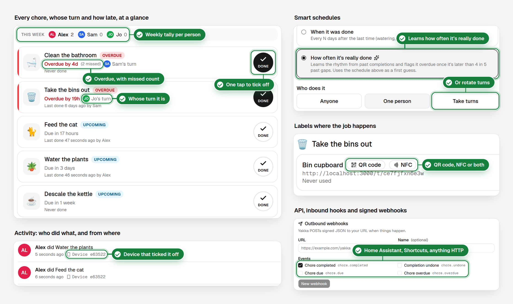
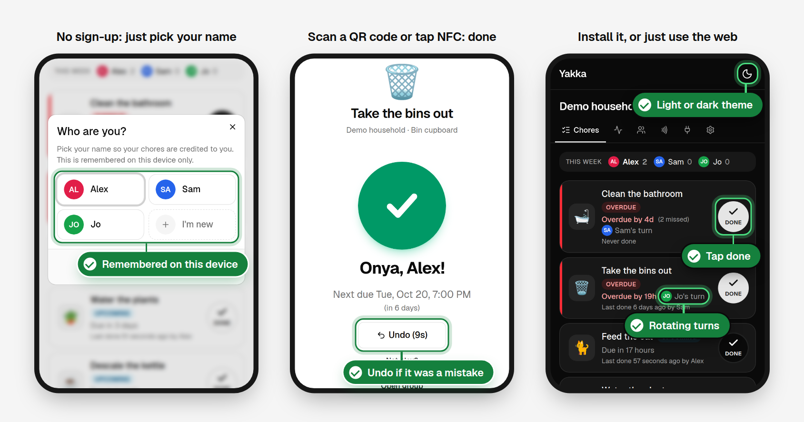

# Yakka

*Yakka* (from Yagara *yaga*, "work") is Australian slang for work, and hard yakka gets done together.

**Share the yakka.** An account-less household chore tracker. Chores are
completed by scanning a QR code or NFC tag stuck where the job happens, or via
the API and webhooks.

Yakka is a simpler take on [DoneTick](https://github.com/donetick/donetick),
built on the access model of [Spliit](https://github.com/spliit-app/spliit):
no sign-up, groups are shared by link, and your identity in each group is
remembered by your browser.

<p align="center">
  
</p>
<p align="center">
  
</p>

> Status: v1 works end to end: groups shared by link, recurring chores with
> due/overdue status, tap-to-complete from QR codes and NFC tags (with undo),
> a REST API, inbound and signed outbound webhooks, Web Push reminders, an
> installable PWA with an offline queue, and Docker (Postgres or SQLite) or
> Vercel deployment. English only for now.

## Development

Requires Node.js 20+ and Docker (for a local Postgres).

```sh
cp .env.example .env      # then adjust if needed
docker compose up -d      # start Postgres
npm install               # also generates the Prisma client
npm run db:migrate        # create the database tables
npm run db:seed           # optional: demo group (prints its URL)
npm run dev               # http://localhost:3000
```

SQLite instead of Postgres: set `DATABASE_URL="file:./data/yakka.db"` in
`.env`, then `npm run db:deploy`. `npm run build` also bundles the service
worker (served at `/sw.js`). The service worker is only registered in production
builds (`npm run build && npm start`).

## Deployment

Use Vercel (with Vercel Cron), or the Docker image
`ghcr.io/mitchelloharawild/yakka` with Postgres (`compose.prod.yaml`) or
SQLite in a single container (`compose.sqlite.yaml`). The PWA, push
notifications and NFC need HTTPS. See [Deployment](docs/DEPLOYMENT.md).

```sh
docker run -d -p 3000:3000 -v yakka-data:/data ghcr.io/mitchelloharawild/yakka
```

## Docs

- [Architecture](docs/ARCHITECTURE.md): data model, tap-to-complete flow,
  identity in the browser, API and webhooks, scheduling and deployment.
- [Development](docs/DEVELOPMENT.md): code layout, conventions and
  Next.js 16 gotchas.
- [Deployment](docs/DEPLOYMENT.md): Vercel, Docker (Postgres or SQLite),
  environment variables, HTTPS, VAPID keys, rate limiting.
- [API](docs/API.md): REST API, inbound hooks, outbound webhooks and
  signature verification.
- [Naming](docs/NAMING.md): how the name was chosen.

## Stack

Next.js 16 (App Router, Cache Components), TypeScript, tRPC + TanStack Query,
Tailwind CSS v4 + shadcn/ui, next-intl, Prisma 7 with PostgreSQL or SQLite, Serwist service worker.

## Acknowledgements

Yakka was coded with the help of
[Claude Code](https://claude.com/claude-code), Anthropic's coding agent.
